# Mixota — Existing Feature Audit & Technical Evaluation Report

**Audited Application:** Mixota by GrowIOTA  
**Auditor:** Senior Software Engineer & Product Auditor  
**Date of Audit:** October 25, 2026  
**Repository Path:** `c:\Users\Dell\Downloads\Mixota-main\Mixota-main`  
**Base Lineage:** Forked and customized from AudioMass (Pantelis Kalogiros, MIT License) with GrowIOTA branding, custom shortcuts system, multitrack studio enhancements, and VIT Community Radio CMS integration.

---

## 1. Executive Summary

Mixota is a client-side, browser-based digital audio workstation (DAW) and waveform editor designed for editing, trimming, multitrack mixing, mastering, and audio restoration. The application operates primarily within the browser's execution runtime using standard Web Audio APIs, HTML5 Canvas, Web Workers, and WebAssembly (WASM).

### Key Findings:
1. **Core Single-Track Audio Engine:** Highly functional and mature. It provides sample-accurate waveform visualization, non-destructive selection, time-domain editing (cut, copy, paste, trim, silence, invert, reverse), 96-step history undo/redo, dynamic compression, equalizers (paragraphic and graphic), delay, distortion, reverb, and ITU-R BS.1770-4 / EBU R128 LUFS loudness measurement and normalization.
2. **Multitrack Studio Engine:** Over 5,500 lines of custom DAW code (`multitrack.js`) providing track creation, track volume/pan/solo/mute, clip moving and boundary slipping, automatic crossfades between overlapping clips, clip duplication, splitting, multitrack live recording overdubbing, an undockable hardware-style mixer (`mix.html`), and full audio mixdown/bounce via `OfflineAudioContext`.
3. **Audio Restoration & DSP:** Features WebAssembly RNNoise neural AI voice denoising (`rnn_denoise.wasm`), 50Hz/60Hz mains hum notch filtering, transient de-clicking (`DeClick`), edit-splice smoothing (`RepairSplice`), and tempo/BPM onset detection (`tempo-estimator.js`).
4. **Export Capabilities:** Real multi-format encoding in background Web Workers: MP3 (via `lamejs` with selectable bitrates), WAV (16-bit, 24-bit, 32-bit float, with TPDF triangular dithering), FLAC (via `libflac.wasm` with compression levels 0–8), and custom binary `.mixota` / `.amss` project sessions. **Note:** OGG and WebM exports are advertised in documentation but **no encoders exist in the codebase**.
5. **VIT Community Radio CMS Round-Trip Workflow:** A dedicated integration module (`mixota-cms.js`) connects Mixota directly to Supabase Cloud Storage and the radio station's episode database. It implements cross-window `postMessage` handshake, signed URL downloads, local IndexedDB draft auto-saving, non-destructive MP3 final take exports (preserving raw source audio), and episode metadata updates.
6. **Backend Infrastructure:** Mixota has **no custom backend API server**. Static local servers in Python (`server.py`, `mixota-server.py`) and Go (`mixota-server.go`) provide local file serving and clean-URL rewrites. Cloud persistence and database operations are executed client-side against Supabase BaaS.
7. **Test & Offline Status:** There is **no automated test suite** (0 unit, integration, or E2E tests). The Service Worker (`sw.js`) registration is commented out in `index.html`, disabling offline PWA capabilities in default deployments.

---

## 2. Project Architecture and Directory Map

### 2.1 Technical Stack Overview

| Layer | Technology | Role |
|---|---|---|
| **Frontend Core** | Vanilla JavaScript (ES5/ES6), HTML5 Canvas | Audio editor runtime, UI components, custom canvas rendering |
| **Audio Processing** | Web Audio API, Web Workers, WebAssembly | DSP filters, non-blocking audio encoding, offline rendering |
| **Waveform Visualization** | WaveSurfer.js 2.x + Regions Plugin | Single-track waveform rendering, zoom, and region selection |
| **Audio Codecs** | LAME (`lame.js`), libFLAC 1.3.3 (`libflac.wasm`), WAV encoder (`wav.js`) | Client-side multiformat audio encoding |
| **Machine Learning / Restoration** | RNNoise WASM (`rnn_denoise.wasm`) | Recurrent neural network voice noise suppression |
| **Local Persistence** | IndexedDB (`mixota-audio`), LZ4 WASM (`lz4-block-codec.wasm`) | Compressed in-browser project draft storage |
| **CMS & Cloud BaaS** | Supabase JS Client (`dist/supabase.js`) | Auth, PostgreSQL metadata (`audio_files`, `episodes`), Storage (`radio-audio`) |
| **Local Servers** | Python 3 `http.server`, Go `net/http` | Development static file servers with clean URL rewrites |
| **Bundling / Build** | Node.js (`build.js`), `uglify-js` | File concatenation and minification into `all.build.js` |

### 2.2 Directory Map

```
Mixota-main/
├── .htaccess                   # Apache clean URLs and MIME types config
├── build.js                    # Node build script to concatenate & uglify JS bundle
├── LICENSE                     # MIT License
├── package.json                # Project manifest (scripts: start, serve, build)
├── README.md                   # Project documentation and feature overview
├── THIRD_PARTY_NOTICES.md      # Open source attributions (WaveSurfer, LAME, FLAC, RNNoise)
├── vercel.json                 # Vercel deployment routing, rewrites, and clean URLs
└── src/
    ├── index.html              # Main single-track and multitrack editor entry point
    ├── editor.html             # Clean URL route target for /editor
    ├── multitrack.html         # Clean URL route target for /multitrack
    ├── home.html / about.html  # Landing page and workstation overview
    ├── features.html           # Feature suite marketing documentation
    ├── workflow.html           # Production workflow documentation
    ├── contact.html            # Contact and support page
    ├── eq.html                 # Frequency Analyser dockable window
    ├── sp.html                 # Spectrum Analyser dockable window
    ├── mix.html                # Multitrack Mixer dockable window
    ├── app.js                  # Central PKAudioEditor application coordinator
    ├── actions.js              # AudioUtils, DSP FXBank (filters, compressor, EQ, reverb, delay)
    ├── engine.js               # WaveSurfer integration, cut/copy/paste, zoom, zero-cross
    ├── multitrack.js           # Full multitrack studio, clips, tracks, lanes, mixdown
    ├── mixota-cms.js           # VIT Community Radio CMS & Supabase cloud round-trip
    ├── mixota-cms.css          # Styling for CMS integration top bar and modals
    ├── mixota-format.js        # .mixota / .amss binary project session serializer
    ├── keys.js                 # Custom keyboard shortcuts manager and settings modal
    ├── state.js                # 96-step undo/redo history with 1.5GB memory trimming
    ├── markers.js              # Time markers and cue region manager
    ├── local.js                # IndexedDB persistence with LZ4 block compression
    ├── recorder.js             # Microphone recorder controller
    ├── recorder-worklet.js     # AudioWorkletProcessor for low-latency mic capture
    ├── ui.js                   # Main UI classes: TopHeader, Toolbar, MainView, BarBtm
    ├── ui-fx.js                # Parameter dialogs for all audio effects and filters
    ├── modal.js                # Accessible modal dialog system
    ├── contextmenu.js          # Right-click contextual menus for clips and tracks
    ├── drag.js                 # File drag-and-drop ingestion handler
    ├── welcome.js              # First-launch welcome dialog and tips
    ├── lufs.js                 # ITU-R BS.1770-4 / EBU R128 loudness measurement
    ├── fx-pg-eq.js             # Interactive Paragraphic EQ visualizer canvas
    ├── fx-auto.js              # Automation curve editor
    ├── tempo-estimator.js      # Onset spectral flux BPM beat detector
    ├── tempo-worker.js         # Background worker for tempo estimation
    ├── lame.js                 # LAME MP3 encoder Web Worker
    ├── wav.js                  # WAV audio encoder Web Worker (16/24/32-bit + dither)
    ├── flac.js / libflac.wasm  # libFLAC audio encoder Web Worker
    ├── rnn_denoise.js / .wasm  # RNNoise neural AI denoising WebAssembly module
    ├── lz4-block-codec.wasm    # LZ4 block compression WebAssembly module
    ├── id3.js                  # ID3v2 (MP3) and ID4 (M4A) metadata reader/writer
    ├── sw.js                   # Service Worker cache script for offline PWA
    ├── manifest.json           # Web App Manifest
    ├── server.py               # Python development server with clean URL rewrites
    ├── mixota-server.py        # Alternative Python server
    ├── mixota-server.go        # Go HTTP development server
    ├── test.mp3                # Built-in demo audio track
    ├── piano-sample.mp3        # Sample piano loop
    ├── dist/
    │   ├── wavesurfer.js       # WaveSurfer core audio library
    │   ├── plugin/wavesurfer.regions.js # WaveSurfer region selection plugin
    │   └── supabase.js         # Supabase client bundle (v2)
    └── mp3/multi/              # Multitrack demo stems (bass, drums, guitars, flute)
```

---

## 3. Complete Existing-Features Matrix

The 94 audited features are categorized and assigned verified statuses according to the standard audit protocol.

| # | Feature | Status | Frontend Location | Backend / Service Location | What Currently Works | Limitations or Missing Parts | Evidence |
|---|---|---|---|---|---|---|---|
| **1. Dashboard & Project Management** |
| 1 | Marketing & Documentation Pages | Implemented and verified | `src/home.html`, `about.html`, `features.html`, `workflow.html`, `contact.html` | Static HTTP Server (`server.py`) | Responsive dark workstation landing page, feature showcase, workflow guides, branding. | Static informational pages; no interactive audio widgets on landing page. | Files exist and verified via `server.py` clean routes. |
| 2 | Local Project Drafts Persistence | Implemented, runtime unverified | `src/ui.js` (L.783–950), `src/local.js` (L.57–273) | IndexedDB (`mixota-audio`) | Saves full audio buffers, channel count, duration, waveforms, and timestamps to IndexedDB. | In-browser IndexedDB only; no cloud sync without CMS mode. | `SaveSession`, `ListSessions`, `GetSession` in `local.js`. |
| 3 | Binary Session Persistence (`.mixota` / `.amss`) | Implemented, runtime unverified | `src/mixota-format.js` (L.61–340), `src/multitrack.js` (L.5300) | Client-side File API | Exports and imports multitrack session binaries including tracks, clips, offsets, and audio buffers. | Proprietary binary chunk format; not compatible with standard Pro Tools / Ableton session files. | Magic byte header `1, 65, 77, 83` in `mixota-format.js`. |
| 4 | Multi-Project Cloud Workspace / User Dashboard | Not found | None | None | N/A | No user account dashboard or cloud project directory exists outside the single active session and CMS mode. | Codebase inspection reveals no user project management portal. |
| **2. Audio Import, Playback & Recording** |
| 5 | Local File Ingestion & Drag-and-Drop | Implemented, runtime unverified | `src/drag.js` (L.52–178), `src/engine.js` (L.217–290) | Client-side FileReader API | Ingests audio files via file picker or drag-and-drop onto the waveform canvas. | Large audio files (>200MB) can cause browser memory spikes during decoding. | `LoadFile`, `LoadArrayBuffer` in `engine.js`. |
| 6 | Remote URL Audio Ingestion | Implemented, runtime unverified | `src/ui.js` (L.534–604), `src/engine.js` (L.378–486) | Client-side `fetch` | Fetches audio from remote HTTP/HTTPS endpoints and decodes into AudioBuffer. | Remote servers must have CORS headers enabled (`Access-Control-Allow-Origin: *`). | `LoadURL` in `engine.js`. |
| 7 | Built-in Sample Audio Loading | Implemented and verified | `src/ui.js` (L.526–532), `src/engine.js` (L.355–376) | Static assets (`src/test.mp3`, `src/mp3/multi/`) | Loads built-in audio sample (`test.mp3`) or multitrack stems directly into the workspace. | Limited to bundled static demo files. | `LoadSample` in `engine.js` L.355. |
| 8 | Audio Buffer Decoding | Implemented and verified | `src/engine.js` (L.94–160), `src/dist/wavesurfer.js` | Web Audio `AudioContext.decodeAudioData` | Decodes MP3, WAV, FLAC, OGG, WebM, AAC, and M4A into raw PCM Float32 audio buffers. | Decoding time is CPU-dependent; long files block main thread briefly. | `wavesurfer.loadDecodedBuffer` in `engine.js`. |
| 9 | Waveform Transport (Play, Pause, Stop, Seek) | Implemented and verified | `src/engine.js` (L.561–687), `src/ui.js` (L.1128–1140) | Web Audio `AudioContext` | Real-time audio playback, cursor tracking, transport controls, skip back/forward. | Single playhead in waveform editor mode. | `RequestPlay`, `RequestPause`, `RequestStop` in `engine.js`. |
| 10 | Multitrack Synced Playback | Implemented, runtime unverified | `src/multitrack.js` (L.3800–4035) | Web Audio `AudioContext` | Synchronous multitrack playback across all tracks, clips, pan positions, and solo/mute states. | High track count (>16 tracks) on low-end hardware can cause buffer underruns. | `Play`, `Pause`, `Stop` in `multitrack.js`. |
| 11 | Microphone Audio Capture | Implemented, runtime unverified | `src/recorder.js` (L.1–374), `src/recorder-worklet.js` | Web Audio `AudioWorkletNode` | Captures mic input using `AudioWorkletNode` with fallback to `ScriptProcessorNode`. | Depends on browser microphone permissions and sample rate matching. | `PKREC` and `pk-recorder` AudioWorklet in `recorder.js`. |
| **3. Waveform Editing** |
| 12 | Multi-channel Waveform Rendering | Implemented and verified | `src/engine.js` (L.13–34), `src/dist/wavesurfer.js` | HTML5 Canvas | Renders split stereo/mono waveforms with zoomable pixel ratio and color tokens (`#00E5A0`). | Split channel display only supports up to 2 channels (stereo). | `WaveSurfer.create` in `engine.js` L.13. |
| 13 | Sample-Accurate Horizontal & Vertical Zooming | Implemented and verified | `src/engine.js` (L.3510–3690), `src/ui.js` (L.3813–3828) | HTML5 Canvas | Smooth horizontal zoom up to sample level; vertical waveform amplitude magnification. | Minimum visible duration clamped to 0.5 seconds for UI stability. | `zoomAt`, `RequestZoom`, `RequestZoomUI` in `engine.js`. |
| 14 | Waveform Panning & Scrubbing | Implemented and verified | `src/engine.js` (L.3582–3720) | DOM / Canvas | Right-click drag panning, shift-wheel scrolling, and overview mini-map scrubbing. | None observed. | `RequestPan` and `drag_move` in `engine.js`. |
| 15 | Zero-Crossing Snapping | Implemented and verified | `src/engine.js` (L.52–75, 3789–3796) | Client-side math | Snaps selection start and end times to the nearest zero-crossing point to prevent clicks. | Clamped to search window of `sampleRate / 125` samples. | `ZeroCrossTime` in `engine.js` L.52. |
| 16 | Peak Separator & Timeline Rulers | Implemented and verified | `src/engine.js` (L.3780–3805) | HTML5 Canvas | Toggles peak amplitude limits and time graduation markers on canvas. | Visual guide only. | `RequestViewPeakSeparatorToggle`, `RequestViewTimelineToggle`. |
| 17 | Follow Cursor During Playback | Implemented and verified | `src/engine.js` (L.3768–3778) | Canvas viewport logic | Automatically scrolls waveform to keep playhead centered during playback. | Disabled when user manually pans canvas. | `RequestViewFollowCursorToggle` in `engine.js`. |
| **4. Multitrack Editing & Timeline** |
| 18 | Track Creation, Deletion & Resizing | Implemented, runtime unverified | `src/multitrack.js` (L.15–18, 5350) | DOM / Canvas | Dynamically adds/removes audio tracks; resizes track lane heights (58px to 240px). | No folder tracks or track grouping. | `addTrack`, `removeTrack` in `multitrack.js`. |
| 19 | Clip Arrangement & Positioning | Implemented, runtime unverified | `src/multitrack.js` (L.2800–3200) | DOM / Canvas | Drag-and-drop clip positioning along timeline, magnetic snapping to grid and markers. | Snapping depends on zoom level. | `clip_drag` handlers in `multitrack.js`. |
| 20 | Clip Split, Duplicate & Delete | Implemented, runtime unverified | `src/multitrack.js` (L.5347–5349) | Client-side math | Splits clips at cursor; duplicates clips with cloned buffers; deletes selected clips. | None observed. | `splitSelectedClip`, `duplicateSelectedClip`, `deleteSelectedClip`. |
| 21 | Clip In/Out Boundary Trimming | Implemented, runtime unverified | `src/multitrack.js` (L.2900–3100) | Client-side audio slice | Non-destructive clip start/end trimming and slip-editing without destroying raw buffer. | None observed. | `clipIn`, `clipOut` in `multitrack.js`. |
| 22 | Automatic Clip Crossfades | Implemented, runtime unverified | `src/multitrack.js` (L.33, 4072, 4147) | Web Audio Gain curves | Automatically computes equal-power crossfades where two clips overlap on the same track. | Crossfade shape is fixed to logarithmic/equal-power curve. | `xfades` and `applyClipEnvelope` in `multitrack.js`. |
| 23 | Track Volume, Pan, Solo & Mute | Implemented, runtime unverified | `src/multitrack.js` (L.4053–4079), `src/mix.html` | Web Audio `GainNode` & `StereoPannerNode` | Per-track gain (0 to 200%), pan (-1.0 to +1.0), exclusive solo, and mute. | Older browsers lacking `StereoPannerNode` fall back to manual channel splitting. | `trackGain`, `trackPan` in `multitrack.js`. |
| 24 | Multitrack Mixer Window | Implemented, runtime unverified | `src/mix.html`, `src/multitrack.js` (L.5344–5346) | Dockable iframe / popup | Hardware-style mixer console with vertical faders, rotary knobs, M/S buttons, and VU meters. | Must be connected to active multitrack session. | `mix.html` standalone window. |
| 25 | Multitrack Mixdown / Bounce | Implemented, runtime unverified | `src/multitrack.js` (L.4037–4161) | Web Audio `OfflineAudioContext` | Renders all tracks, clips, envelopes, pan, and master gain into a single stereo AudioBuffer. | CPU intensive for sessions with 20+ clips on long timelines. | `Mixdown`, `MixdownAsync` in `multitrack.js`. |
| 26 | Beat Grid & BPM Snapping | Implemented, runtime unverified | `src/multitrack.js` (L.27–31, 87–95) | HTML5 Canvas | Draws musical beat grid (4/4, 3/4, 6/8); snaps clip movements to musical bars and beats. | Static tempo map only; no variable tempo automation. | `beat_canvas`, `beat_bpm`, `beat_sig` in `multitrack.js`. |
| **5. Selection, Cutting, Trimming & Pasting** |
| 27 | Time Range Region Selection | Implemented and verified | `src/engine.js` (L.25–31, 873–910), `wavesurfer.regions.js` | HTML5 Canvas | Interactive click-and-drag selection box with draggable resize handles. | Only one active primary region selection in single-track mode. | `WaveSurfer.regions.create` in `engine.js`. |
| 28 | Select All / Deselect All | Implemented and verified | `src/engine.js` (L.873–910), `src/ui.js` (L.1142–1153) | DOM / Canvas | Quickly expands selection to full audio duration or collapses selection to playhead. | None. | `RequestSelect`, `RequestDeselect` in `engine.js`. |
| 29 | Audio Cut | Implemented, runtime unverified | `src/engine.js` (L.1212–1260), `src/actions.js` (L.125–150) | Client-side PCM slice | Removes selected audio from AudioBuffer, copies it to clipboard, and closes the gap. | Modifies audio buffer in memory; undoable via state stack. | `RequestActionCut` in `engine.js`. |
| 30 | Audio Copy & Internal Clipboard | Implemented, runtime unverified | `src/engine.js` (L.1261–1283), `src/actions.js` (L.49–71) | In-memory AudioBuffer | Copies selected time range of active channels into internal memory clipboard. | Internal clipboard only; does not write audio PCM to OS system clipboard. | `RequestActionCopy`, `CopyBufferSegment` in `actions.js`. |
| 31 | Audio Paste | Implemented, runtime unverified | `src/engine.js` (L.1324–1377), `src/actions.js` (L.151–210) | Client-side PCM insert | Inserts clipboard audio at playhead position, expanding total file duration. | Sample rates between copied audio and destination must match. | `RequestActionPaste`, `InsertSegmentToBuffer` in `actions.js`. |
| 32 | Audio Trim to Selection | Implemented, runtime unverified | `src/engine.js` (L.1212–1260), `src/actions.js` (L.79–124) | Client-side PCM crop | Deletes all audio outside the current region selection, retaining only the selected segment. | Modifies audio buffer in memory; undoable via state stack. | `TrimBuffer`, `OverwriteBufferWithSegment`. |
| 33 | Audio Silence / Deletion | Implemented, runtime unverified | `src/engine.js` (L.1284–1323), `src/actions.js` (L.37–46) | Zero-fill PCM buffer | Overwrites selected time range with absolute digital silence (0.0 float values). | Duration remains unchanged. | `RequestActionSilence`, `MakeSilenceBuffer`. |
| **6. Undo, Redo & Editing History** |
| 34 | 96-Level Audio History Engine | Implemented, runtime unverified | `src/state.js` (L.1–228), `src/engine.js` (L.3376–3412) | In-memory snapshot stack | Maintains up to 96 undo/redo states with intelligent 1.5GB memory budget trimming and 10-step guarantee. | Deep undo history of long files consumes browser RAM. | `PKState`, `_max_bytes = 1.5GB` in `state.js`. |
| 35 | Multitrack & Marker Undo States | Implemented, runtime unverified | `src/state.js` (L.89–98), `src/markers.js` (L.67–69) | Typed state snapshots | Preserves multitrack arrangement snapshots (`type: 'mult'`) and marker updates (`type: 'mrk'`). | Separate undo paths managed through unified coordinator. | `type === 'mult'`, `type === 'mrk'` in `state.js`. |
| **7. Volume, Gain, Fades & Normalization** |
| 36 | Gain Automation Curves | Implemented, runtime unverified | `src/actions.js` (L.1402–1446), `src/ui-fx.js` (L.208) | Web Audio `GainNode` | Multi-point envelope drawing for smooth linear volume ramps across time. | User must set envelope points manually. | `FXBank.Gain` in `actions.js`. |
| 37 | Fade In & Fade Out | Implemented, runtime unverified | `src/actions.js` (L.1447–1474), `src/engine.js` (L.2709–2777) | Logarithmic Gain Curves | Applies smooth logarithmic fade-in or fade-out to selected audio. | Fixed curve shape. | `FadeIn`, `FadeOut` in `actions.js`. |
| 38 | Peak Normalization | Implemented, runtime unverified | `src/actions.js` (L.1565–1586), `src/ui-fx.js` (L.935–980) | Peak sample scanning | Analyzes absolute peak amplitude and scales buffer to target dB (default 0 dB or -0.1 dB). | Does not account for perceived loudness. | `FXBank.Normalize` in `actions.js`. |
| 39 | RMS Normalization | Implemented, runtime unverified | `src/actions.js` (L.1587–1608), `src/ui-fx.js` (L.981–1020) | Root-mean-square math | Scales audio based on root-mean-square average energy. | Can cause clipping if target RMS is set too high without a limiter. | `FXBank.NormalizeRMS` in `actions.js`. |
| 40 | LUFS Loudness Normalization | Implemented, runtime unverified | `src/actions.js` (L.1609–1632), `src/lufs.js` (L.88–180) | ITU-R BS.1770-4 K-weighting | Normalizes audio to broadcast standards (e.g., -14 LUFS Spotify/YouTube, -16 LUFS Apple Podcast, -23 LUFS EBU R128). | Integrated LUFS only; does not provide dynamic multi-band leveling. | `NormalizeLUFS` and `lufs.js`. |
| 41 | Hard Limiter | Implemented, runtime unverified | `src/actions.js` (L.1633–1703), `src/ui-fx.js` (L.1502–1580) | Sample clamping & lookahead | Hard limits peaks above threshold with configurable release curve to prevent clipping. | Aggressive limiting can cause audible distortion. | `FXBank.HardLimit` in `actions.js`. |
| **8. Audio Effects, EQ, Compression & Filters** |
| 42 | Paragraphic Equalizer | Implemented, runtime unverified | `src/actions.js` (L.1704–1828), `src/fx-pg-eq.js` (L.1–400) | Web Audio `BiquadFilterNode` | Interactive canvas curve with draggable filter nodes (peaking, low-shelf, high-shelf, notch). | Requires Web Audio biquad stability. | `FXBank.ParametricEQ` and `fx-pg-eq.js`. |
| 43 | Graphic Equalizer (10 & 20 Band) | Implemented, runtime unverified | `src/actions.js` (L.1704–1828), `src/ui-fx.js` (L.1242–1350) | ISO standard filter bank | 10-band octave and 20-band 1/2-octave graphic EQ fader banks from 31Hz to 16kHz. | Fixed ISO frequency bands. | `RequestActionFXUI_GraphicEQ`. |
| 44 | Dynamic Compressor | Implemented, runtime unverified | `src/actions.js` (L.1475–1506), `src/ui-fx.js` (L.770–850) | Web Audio `DynamicsCompressorNode` | Threshold (-100 to 0dB), Knee (0 to 40dB), Ratio (1 to 20), Attack (0 to 1s), Release (0 to 1s). | Single-band compressor; no multi-band compression. | `FXBank.Compressor` in `actions.js`. |
| 45 | Delay Effect | Implemented, runtime unverified | `src/actions.js` (L.2074–2177), `src/ui-fx.js` (L.1581–1650) | Web Audio `DelayNode` + Feedback | Configurable delay time (0 to 2000ms), feedback percentage, and wet/dry mix. | Simple feedback loop; no ping-pong or stereo tap offset. | `FXBank.Delay` in `actions.js`. |
| 46 | Distortion / Overdrive | Implemented, runtime unverified | `src/actions.js` (L.2178–2257), `src/ui-fx.js` (L.1687–1760) | Web Audio `WaveShaperNode` | Non-linear polynomial distortion curve with drive and post-gain controls. | Digital clipping curve; no tube/tape analog modeling. | `FXBank.Distortion` in `actions.js`. |
| 47 | Algorithmic Reverb | Implemented, runtime unverified | `src/actions.js` (L.2286–2360), `src/ui-fx.js` (L.1770–1850) | Web Audio `ConvolverNode` | Generates synthetic room/hall impulse response with decay time, pre-delay, and wet/dry mix. | Algorithmic synthetic IR; no external custom IR WAV loader. | `FXBank.Reverb` in `actions.js`. |
| 48 | Invert Phase & Channel Flip | Implemented, runtime unverified | `src/actions.js` (L.1522–1564), `src/ui-fx.js` (L.578–650) | Sample arithmetic | Inverts polarity (`-1 * sample`); swaps left and right channels; isolates left or right channel. | Stereo/mono files only. | `FXBank.Invert`, `FXBank.Flip`. |
| 49 | Reverse Audio | Implemented, runtime unverified | `src/actions.js` (L.1507–1521), `src/engine.js` (L.2627–2660) | Array reversal | Reverses audio samples within the selected region or whole track. | Reverses in-place in memory. | `FXBank.Reverse` in `actions.js`. |
| 50 | Speed & Playback Rate Modulation | Implemented, runtime unverified | `src/actions.js` (L.1829–1950), `src/engine.js` (L.3262–3374) | Resampling / BufferSource | Adjusts playback speed with pitch coupling or renders Doppler-style speed ramps. | Changes both tempo and pitch concurrently (resampling); no time-stretch without pitch shift. | `FXBank.Speed`, `FXBank.Rate`. |
| 51 | Real-time Effect Preview Engine | Implemented, runtime unverified | `src/actions.js` (L.800–910), `src/engine.js` (L.1468–1800) | Web Audio live graph | Previews audio effects non-destructively in real-time before committing to the buffer. | Preview audio runs in parallel with UI sliders. | `FXPreviewBuffer`, `FXPreviewStop`. |
| **9. Noise Reduction & Restoration** |
| 52 | RNNoise AI Neural Voice Denoising | Implemented, runtime unverified | `src/engine.js` (L.2662–2708), `src/rnn_denoise.js`, `rnn_denoise.wasm` | WebAssembly RNNoise model | Recurrent neural network deep-learning filter trained to eliminate background noise from speech. | Model is optimized for speech; can attenuate musical instruments. | `RequestActionFX_NoiseRNN` and `rnn_denoise.wasm`. |
| 53 | 50Hz / 60Hz Mains Hum Elimination | Implemented, runtime unverified | `src/actions.js` (L.2258–2285), `src/engine.js` (L.2518–2541) | Cascaded Notch Filters | Sharp biquad notch filters targeting 50Hz (EU/UK/Asia) or 60Hz (US) mains hum and upper harmonics. | Slightly attenuates sub-bass frequencies around notch centers. | `FXBank.HumNotch` in `actions.js`. |
| 54 | Click & Pop Removal (De-Click) | Implemented, runtime unverified | `src/engine.js` (L.2542–2572), `src/ui-fx.js` (L.1873–1930) | Transient derivative scanning | Scans sample derivatives for vinyl clicks/ticks and repairs them via polynomial interpolation. | High sensitivity settings can soften sharp percussive transients. | `RequestActionFX_DeClick`, `deClickChannel`. |
| 55 | Splice & Edit Point Repair | Implemented, runtime unverified | `src/engine.js` (L.2596–2626), `src/ui-fx.js` (L.1873–1930) | Discontinuity smoothing | Detects waveform discontinuities at edit splice points and smooths them to eliminate pops. | Clamped to short splice windows (<512 samples). | `RequestActionFX_RepairSplice`, `repairSpliceChannel`. |
| 56 | Remove Silence | Implemented, runtime unverified | `src/engine.js` (L.2016–2150), `src/ui.js` (L.1333–1337) | Threshold gate scanning | Automatically scans for and splices out audio sections below dB threshold. | Fixed hysteresis window. | `RequestActionFX_RemSil` in `engine.js`. |
| 57 | Spectral Editing / Spectral Repair | Not found | None | None | N/A | No STFT 2D spectrogram paintbrush or spectral frequency selection tool exists in the application. | Audited codebase contains only time-domain restoration tools. |
| **10. Recording Tools & Microphone Support** |
| 58 | Hardware Microphone Input Selection | Needs manual testing | `src/recorder.js` (L.1–150) | Browser `navigator.mediaDevices` | Requests audio device stream with echo cancellation and auto gain controls. | Requires physical microphone and browser security permissions prompt. | `getUserMedia` in `recorder.js`. |
| 59 | Live Recording Waveform Visualizer | Implemented, runtime unverified | `src/recorder.js` (L.150–250), `src/multitrack.js` (L.104–106) | HTML5 Canvas | Draws real-time scrolling waveform while recording from microphone. | Frame rate throttled on low-end GPUs. | `rec_canvas`, `rec_raf` in `multitrack.js`. |
| 60 | Multitrack Overdub Recording | Implemented, runtime unverified | `src/multitrack.js` (L.5341–5343) | Web Audio + Canvas | Records live microphone take onto a new or existing track while monitoring existing tracks. | Latency compensation depends on hardware audio buffer size. | `RecordStart`, `RecordStop` in `multitrack.js`. |
| **11. Export Formats, Settings & Metadata** |
| 61 | MP3 Export with Bitrate Selection | Implemented, runtime unverified | `src/actions.js` (L.927–929), `src/lame.js` | Web Worker (`lamejs`) | Encodes audio to MP3 format in background worker with bitrates: 128, 160, 192, 256, 320 kbps. | Background worker encoding takes several seconds for long audio tracks. | `format === 'mp3'`, `worker = new Worker('lame.js')`. |
| 62 | WAV Export with Bit Depth & Dithering | Implemented, runtime unverified | `src/actions.js` (L.933–1010), `src/wav.js` | Web Worker | Encodes uncompressed PCM WAV in 16-bit, 24-bit, or 32-bit float; optional TPDF triangular dithering. | Large file size characteristic of uncompressed WAV. | `convert16dith`, `convert24`, `wav.js`. |
| 63 | FLAC Lossless Export | Implemented, runtime unverified | `src/actions.js` (L.930–932), `src/flac.js`, `libflac.wasm` | Web Worker (`libFLAC`) | Encodes lossless FLAC with user-selectable compression levels (0 to 8). | Slower encoding speed at compression level 8. | `format === 'flac'`, `libflac.wasm`. |
| 64 | OGG Vorbis & WebM Audio Export | Not found | None | None | N/A | Advertised in README documentation, but **no OGG Vorbis or WebM encoders exist in the codebase**. | Inspection of `actions.js` L.927–936 confirms only MP3, FLAC, and WAV workers exist. |
| 65 | ID3v2 & ID4 Metadata Tag Editor | Implemented, runtime unverified | `src/id3.js` (L.1–450), `src/engine.js` (L.3832–3866) | Binary parser / serializer | Reads and writes ID3v2 (MP3) and ID4 (M4A) tags: Title, Artist, Album, Year, and Comments. | Embedded album art image editing is not supported. | `ID3v2.ReadTags`, `ID4.ReadTags` in `id3.js`. |
| **12. Audio Analysis, Meters & Loudness** |
| 66 | ITU-R BS.1770-4 / EBU R128 LUFS Meter | Implemented, runtime unverified | `src/lufs.js` (L.1–241), `src/actions.js` (L.73–76) | K-weighting biquad filters | Full implementation of BS.1770-4: Integrated Loudness (LUFS), Loudness Range (LRA), and True Peak (dBTP). | Offline batch analysis only; not displayed as a continuous live streaming meter during playback. | `analyze` in `lufs.js` L.88. |
| 67 | Dockable Frequency Analyser | Implemented, runtime unverified | `src/eq.html`, `src/ui.js` (L.1403–1420) | Web Audio `AnalyserNode` + Canvas | FFT frequency curve with dockable/undockable window support (`?iframe` mode). | FFT window size fixed at 2048 bins. | `eq.html` and `RequestShowFreqAn`. |
| 68 | Dockable Spectrum Analyser | Implemented, runtime unverified | `src/sp.html`, `src/ui.js` (L.1422–1439) | Web Audio `AnalyserNode` + Canvas | Waterfall/bar spectrum analyzer with peak holds and dockable popup window support. | Visual display only. | `sp.html` and `RequestShowFreqAn`. |
| 69 | Tempo & BPM Detection | Implemented, runtime unverified | `src/tempo-estimator.js` (L.1–213), `src/tempo-worker.js` | Spectral flux onset worker | Analyzes onset energy flux and inter-onset peak histograms to detect tempo in BPM. | Accuracy depends on clear percussive beats; ambient audio can produce octave errors. | `intervalTempo`, `makeFlux` in `tempo-estimator.js`. |
| 70 | Multitrack Mixer VU Meters | Implemented, runtime unverified | `src/mix.html` (L.18–19), `src/multitrack.js` (L.100) | HTML5 Canvas / CSS transforms | Per-channel RMS/peak level indicators on multitrack mixer channel strips. | Updates throttled to animation frames. | `.meter i` in `mix.html`. |
| **13. Markers, Looping & Navigation** |
| 71 | Cue Marker System | Implemented, runtime unverified | `src/markers.js` (L.1–387), `src/ui.js` (L.47) | Canvas overlays / State stack | Adds named, color-coded time markers; jump to next/prev marker; serializes to project files. | Maximum 11 character label display clamp (`max = 11`). | `PKMrk` in `markers.js`. |
| 72 | Seamless Loop Finder & Matcher | Implemented, runtime unverified | `src/actions.js` (L.2817–2858), `src/ui-fx.js` (L.1975–2050) | Zero-cross correlation | Analyzes selection boundaries to find natural periodic loop points and crossfade match them. | Best suited for repetitive loops (beats, pads). | `RequestActionFXUI_SeamlessLoop`. |
| 73 | Transport Loop Mode | Implemented and verified | `src/engine.js` (L.644–680), `src/ui.js` | WaveSurfer region loop | Seamlessly loops playback over the selected time range or entire file. | None. | `RequestSetLoop` in `engine.js`. |
| **14. CMS Integration & Round-Trip** |
| 74 | CMS Query Handshake & Opener Protocol | Implemented, runtime unverified | `src/mixota-cms.js` (L.18–30, 928–987) | Cross-window `postMessage` | Reads `recordingId`, `episodeId`, `cmsOrigin`; establishes bi-directional handshake with CMS opener. | Requires valid query params (`recordingId`) to trigger activation. | `MIXOTA_SESSION_REQUEST` / `MIXOTA_SESSION_RESPONSE`. |
| 75 | CMS Integration Top Bar | Implemented and verified | `src/mixota-cms.js` (L.106–157), `src/mixota-cms.css` | DOM Injection | Shows "VIT Radio 90.8 FM" badge, episode title, original filename, status dot, and action buttons. | Occupies top 42px of editor viewport. | `renderCmsBar` in `mixota-cms.js` L.106. |
| 76 | Signed URL Audio Download with Progress | Implemented, runtime unverified | `src/mixota-cms.js` (L.287–350, 426–465) | Supabase Storage API (`radio-audio`) | Requests 1-hour signed URL; downloads raw audio with chunked stream percentage meter into editor. | Link expires in 3600 seconds. | `createSignedUrl` in `mixota-cms.js` L.340. |
| 77 | In-Progress Project Auto-Drafting | Implemented, runtime unverified | `src/mixota-cms.js` (L.404–423, 507–571) | IndexedDB (`sessions` store) | Auto-saves audio buffer and markers to IndexedDB under key `cms_<recordingId>` to prevent loss. | In-browser IndexedDB only; clears if browser cache is purged. | `cms_` key prefix in `mixota-cms.js` L.540. |
| 78 | Non-Destructive Final Audio Export to CMS | Implemented, runtime unverified | `src/mixota-cms.js` (L.573–836) | Supabase Storage & Database | Encodes MP3 via Web Worker; uploads to `episodes/<id>/`; inserts `audio_files` row; assigns `episodes.final_audio_file_id`. | Leaves raw `audio_file_id` untouched to preserve original recording for QC. | `uploadFinalAudioToCms` in `mixota-cms.js` L.744. |
| 79 | Return to CMS & Unsaved Edits Guard | Implemented, runtime unverified | `src/mixota-cms.js` (L.868–926) | DOM Modal / Window navigation | Warns user of unsaved edits before closing; notifies CMS opener via `MIXOTA_RETURN_TO_CMS`; navigates back. | Browser popup blocking may prevent `window.close()`. | `returnToCms` in `mixota-cms.js` L.868. |
| **15. Authentication & Permissions** |
| 80 | Supabase Email/Password Station Sign-In | Implemented, runtime unverified | `src/mixota-cms.js` (L.220–284), `src/dist/supabase.js` | Supabase Auth API | Provides interactive sign-in modal when no active session is passed from CMS opener. | Requires valid VIT Community Radio station credentials. | `supabase.auth.signInWithPassword` in `mixota-cms.js`. |
| 81 | Row Level Security (RLS) Permission Handling | Implemented, runtime unverified | `src/mixota-cms.js` (L.297–305, 1097–1130) | Supabase RLS | Catches RLS unauthorized errors from Supabase and displays clear access denied notifications. | RLS policies are enforced server-side by Supabase. | RLS error catch in `mixota-cms.js` L.299. |
| 82 | Role-Based Access Control (RBAC) UI | Not found | None | None | N/A | No user role management or permissions assignment screen exists inside Mixota. | All RBAC management is handled externally in the VIT Radio CMS. |
| **16. Database & Storage Architecture** |
| 83 | IndexedDB Storage with WASM LZ4 Compression | Implemented, runtime unverified | `src/local.js` (L.9–53), `src/lz4-block-codec.wasm` | IndexedDB + WebAssembly | Compresses raw Float32 audio channel arrays with LZ4 before writing to IndexedDB to minimize quota usage. | Falls back to uncompressed storage if WASM fails to initialize. | `lz4BlockCodec.createInstance` in `local.js` L.22. |
| 84 | Supabase Cloud Storage (`radio-audio`) | Implemented, runtime unverified | `src/mixota-cms.js` (L.15, 756) | Supabase Storage Bucket | Stores finished broadcast MP3 takes under partitioned episode directories. | Requires active internet connection. | `AUDIO_BUCKET = 'radio-audio'` in `mixota-cms.js`. |
| 85 | Supabase Database Schema Integration | Implemented, runtime unverified | `src/mixota-cms.js` (L.291–327, 770–813) | Supabase PostgreSQL tables | Selects from `audio_files`, updates `episodes`, and calls RPC fallback `admin_attach_audio`. | Schema must maintain expected column names (`final_audio_file_id`, `storage_path`). | PostgREST queries in `mixota-cms.js`. |
| **17. UI/UX, Keyboard Shortcuts & Accessibility** |
| 86 | Custom Keyboard Shortcuts Manager & Rebinding | Implemented and verified | `src/keys.js` (L.1–1756), `src/ui.js` (L.1612–1622) | `localStorage` (`mixota_shortcuts_v1`) | Full shortcut modal, customizable key combinations, conflict detection, category filters, reset defaults. | Modal navigation only. | `ShortcutManager` and `mixota_shortcuts_v1` in `keys.js`. |
| 87 | Dark Workstation Design System | Implemented and verified | `src/main.css`, `src/mixota-cms.css`, `src/home.html` | Vanilla CSS | Bespoke dark workstation aesthetic (`#050605` background, `#00E5A0` mint accents, JetBrains Mono font). | None. | Design tokens in `:root` of `home.html` and `main.css`. |
| 88 | Dockable Window Popout Architecture | Implemented, runtime unverified | `src/ui.js` (L.1403–1459), `eq.html`, `sp.html`, `mix.html` | Cross-window communication | Docks analyzers and mixers into bottom dock or detaches into independent multi-monitor OS popout windows. | Popups must be allowed by browser settings. | `PKAudioEditor.ui.Dock` in `eq.html` and `mix.html`. |
| 89 | Mobile Touch UX & Orientation Prompts | Implemented and verified | `src/ui.js` (L.104), `src/welcome.js` (L.29–35) | Responsive CSS / Touch events | Detects mobile devices (`pk_mob`), displays physical silent switch reminders, and touch zoom helpers. | Audio editing complex timelines on small phone screens is ergonomically constrained. | `PKAE.isMobile` in `welcome.js`. |
| 90 | Screen Reader & ARIA Accessibility | Partially implemented | `src/ui.js`, `src/modal.js` | HTML ARIA attributes | Basic modal dialog labels and button titles exist. | Waveform canvas, clip handles, and timeline lanes have **no ARIA equivalents or screen reader audio cues**. | Canvas elements lack assistive role descriptions. |
| **18. Error Handling, Testing & Performance** |
| 91 | Automated Test Suite | Not found | None | None | N/A | **Zero automated test files exist** in the repository (no Jest, Vitest, Cypress, or Playwright configurations). | `package.json` contains only build and server scripts. |
| 92 | Offline PWA & Service Worker | Broken or blocked | `src/sw.js`, `src/manifest.json`, `src/index.html` (L.70–74) | Browser Cache Storage | `sw.js` caches all core scripts, styles, and WASM binaries for offline execution. | **Registration is commented out in `index.html`** (`// navigator.serviceWorker.register('sw.js')`); unbundled scripts loaded in dev mode. | Commented registration in `index.html` L.72. |
| 93 | Web Worker & WASM Performance Offloading | Implemented, runtime unverified | `src/lame.js`, `flac.js`, `wav.js`, `rnn_denoise.wasm` | Web Workers / WebAssembly | Heavy audio DSP and codecs run completely off the main UI thread. | First load of WASM modules incurs small download overhead. | Web Worker instantiations in `actions.js` and `engine.js`. |
| 94 | Local Static Web Server Scripts | Implemented and verified | `src/server.py`, `src/mixota-server.py`, `src/mixota-server.go` | Python 3 / Go `net/http` | Local development server with clean URL rewrites (redirects `.html` to clean paths, serves on port 5055). | Static development servers only; no backend processing capabilities. | `server.py` L.1–75. |

---

## 4. Fully Implemented Features

The following features have complete implementations that have been structurally and logically verified through safe code path analysis:

1. **Precision Single-Track Waveform Visualization (`src/engine.js`, `src/dist/wavesurfer.js`):** Multi-channel Canvas rendering with custom GrowIOTA mint branding (`#00E5A0`), peak separator guides, sample-accurate zoom up to single-sample resolution, and timeline markers.
2. **Interactive Range Region Selection (`src/dist/plugin/wavesurfer.regions.js`):** Visual selection box with draggable resize boundaries, start/end/duration time indicators, and automatic zero-crossing snapping (`ZeroCrossTime` in `engine.js`).
3. **Core Transport Engine (`src/engine.js`):** Real-time playback, pause, stop, click-to-seek, cursor centering, follow-cursor toggling, and seamless region looping (`RequestSetLoop`).
4. **Custom Keyboard Shortcuts & Settings Panel (`src/keys.js`):** Complete shortcut manager with key combination recording, modifier normalization (`Cmd` on macOS vs `Ctrl` on Windows/Linux), conflict detection, category browsing, and `localStorage` persistence (`mixota_shortcuts_v1`).
5. **Modern Dark Workstation Design System (`src/main.css`, `src/home.html`):** Polished aesthetic utilizing curated HSL/hex palettes, JetBrains Mono and Inter typography, subtle glassmorphic panels, and animated micro-interactions.
6. **Static File Development Servers with Clean URLs (`src/server.py`, `src/mixota-server.py`, `src/mixota-server.go`):** Permanent 301 redirects for legacy `.html` extensions and rewrites routing `/editor` and `/multitrack` to `/index.html`.
7. **CMS Top Banner & Navigation Header (`src/mixota-cms.js`, `src/mixota-cms.css`):** Dynamic branding banner displaying station metadata ("VIT Radio 90.8 FM"), active episode title, file reference, and action buttons.

---

## 5. Partially Implemented Features

The following features have substantial code present, but remain incomplete or exhibit notable functional gaps:

1. **Accessibility & Screen Reader Support (`src/ui.js`, `src/modal.js`):** While modal dialogs feature basic focus trapping and button tooltips, the primary editing interfaces (HTML5 Canvas waveforms, multitrack timeline lanes, clip boundaries, and automation envelopes) are completely opaque to assistive technology. There are no ARIA live regions or screen-reader descriptions for playhead position, selection boundaries, or audio levels.
2. **Audio Tag Editing (`src/id3.js`, `src/ui.js`):** ID3 tag editing reads and writes standard text fields (title, artist, album, year, comment) for MP3 (ID3v2.3) and M4A (ID4), but **does not support album artwork embedding**, genre selection, or extended podcast RSS metadata fields.
3. **Single-Track Time-Stretching (`src/actions.js` L.1829):** The `Speed` and `Rate` tools resample the buffer, changing pitch and tempo simultaneously (classic tape/vinyl effect). There is **no phase vocoder or WSOLA time-stretching algorithm** to stretch time without altering pitch.

---

## 6. UI-Only and Disconnected Features

Features where interface controls or documentation exist, but no functional underlying implementation is wired:

1. **Claimed OGG & WebM Audio Export:**
   - **Where it appears:** `README.md` (L.17) advertises: *"Broad Format Support: Export and import MP3, WAV, FLAC, OGG, WebM..."*
   - **Actual Implementation:** In `src/actions.js` (L.927–935), the export function only instantiates workers for `mp3` (`lame.js`), `flac` (`flac.js`), and `wav` (`wav.js`). While the browser can decode OGG and WebM on **import**, **no export encoders exist** for OGG Vorbis or WebM audio in Mixota.
2. **Album Art & Artwork Previews in ID3 Modal:**
   - The UI modal shows placeholder tags, but image upload and embedded APIC frame encoding are disconnected.

---

## 7. Missing Features

Features that are neither implemented in the codebase nor present in UI handlers:

1. **Automated Test Suite:** Zero unit tests, integration tests, or end-to-end browser automation scripts exist in the repository.
2. **Multi-Project Cloud Dashboard:** Mixota has no project listing dashboard or multi-session manager for independent users. It operates as a single-session tool unless invoked via the VIT Community Radio CMS.
3. **Spectral Frequency Editing:** There is no 2D spectrogram visualizer or spectral frequency selection tool (such as iZotope RX or Adobe Audition spectral repair). Restoration is strictly time-domain (DeClick and RepairSplice) plus neural time-domain RNNoise.
4. **Multi-band Compression:** The compressor is strictly single-band (`DynamicsCompressorNode`).
5. **Real-time VST / AU / Web Audio Plugin Support:** No external plugin hosting framework exists.

---

## 8. CMS Integration Audit (VIT Community Radio CMS)

Mixota includes a dedicated enterprise integration module for the **VIT Community Radio (90.8 FM) CMS** located in `src/mixota-cms.js` and `src/dist/supabase.js`.

```mermaid
sequenceDiagram
    autonumber
    actor Producer as Radio Producer / Sound Engineer
    participant CMS as VIT Radio CMS (vitradio.growiota.in)
    participant Mixota as Mixota Studio (localhost:5055)
    participant SupabaseAuth as Supabase Auth (qqoybhevvnkycepujosm)
    participant SupabaseDB as Supabase Database (PostgreSQL)
    participant SupabaseStorage as Supabase Storage (radio-audio bucket)

    Producer->>CMS: Clicks "Edit with Mixota" on Episode Recording
    CMS->>Mixota: Opens Mixota with URL params (?recordingId=...&episodeId=...)
    Mixota->>Mixota: renderCmsBar() displays "VIT Radio 90.8 FM" banner
    
    rect rgb(20, 25, 22)
    Note over Mixota,CMS: Bi-directional Handshake Protocol
    Mixota->>CMS: postMessage('MIXOTA_SESSION_REQUEST') to window.opener
    CMS-->>Mixota: postMessage('MIXOTA_SESSION_RESPONSE', { session, signedUrl })
    opt Opener not found or direct link
        Mixota->>SupabaseAuth: Prompt Station Login Modal (email/password)
        SupabaseAuth-->>Mixota: Returns authenticated JWT session
    end
    end

    rect rgb(22, 28, 25)
    Note over Mixota,SupabaseStorage: Secure Audio Ingestion & Local Draft
    Mixota->>SupabaseDB: Query audio_files & episodes metadata (validates RLS)
    SupabaseDB-->>Mixota: Returns storage_path & episode details
    Mixota->>SupabaseStorage: createSignedUrl(storage_path, 3600)
    SupabaseStorage-->>Mixota: Short-lived signed download URL
    Mixota->>SupabaseStorage: Chunked fetch() stream with progress indicator
    Mixota->>Mixota: Decode AudioBuffer & render waveform
    Mixota->>Mixota: Auto-saves local draft to IndexedDB (key: cms_<recordingId>)
    end

    Producer->>Mixota: Edits audio (trims, noise reduction, EQ, normalization)
    Producer->>Mixota: Clicks "⬆ Export & Return to CMS"
    
    rect rgb(25, 30, 26)
    Note over Mixota,CMS: Non-Destructive Round-Trip Export
    Mixota->>Mixota: Prompts bitrate (128/192/256 kbps) & filename
    Mixota->>Mixota: Encodes MP3 via lame.js Web Worker (progress %)
    Mixota->>SupabaseStorage: Uploads to episodes/<episodeId>/<timestamp>-<name>.mp3
    Mixota->>SupabaseDB: Inserts new row in audio_files table
    Mixota->>SupabaseDB: Updates episodes.final_audio_file_id (RAW audio_file_id untouched!)
    Mixota->>CMS: postMessage('MIXOTA_EXPORT_COMPLETE', { episodeId, audioFileId })
    Mixota->>Producer: Displays Success Confirmation Modal
    Mixota->>CMS: Closes tab or navigates back to /admin/episodes/<id>
    end
```



### Detailed Verification of CMS Integration Criteria:

| Verification Item | Implementation Status | Code Evidence | Technical Assessment |
|---|---|---|---|
| **Open Correct Audio File** | Implemented, runtime unverified | `src/mixota-cms.js` L.291–309 | Queries `audio_files` table by `recordingId`; fetches exact `storage_path`. |
| **Pass Secure File Reference** | Implemented, runtime unverified | `src/mixota-cms.js` L.339–347 | Generates 3600-second private signed URL using Supabase Storage client. |
| **Identify Associated Record** | Implemented, runtime unverified | `src/mixota-cms.js` L.313–327 | Resolves `episode_id` and queries `episodes` table for title and status. |
| **Preserve Original Audio** | Implemented and verified | `src/mixota-cms.js` L.793–800 | **Crucial:** Updates `episodes.final_audio_file_id` leaving the raw `audio_file_id` completely untouched. The raw recording is preserved permanently. |
| **Save Edited Audio as New Version** | Implemented, runtime unverified | `src/mixota-cms.js` L.771–791 | Inserts a brand new record into `audio_files` table with unique ID, file size, duration, and uploader UUID. |
| **Re-upload to Correct CMS Record** | Implemented, runtime unverified | `src/mixota-cms.js` L.753–764 | Uploads to isolated bucket path: `episodes/<episodeId>/<timestamp>-<safeName>.mp3`. |
| **Handle Auth & Expired Sessions** | Implemented, runtime unverified | `src/mixota-cms.js` L.220–284 | Intercepts expired sessions; presents VIT Radio station sign-in modal; refreshes Supabase session token. |
| **Show Upload Progress & Errors** | Implemented and verified | `src/mixota-cms.js` L.613–675 | Dedicated progress modal tracks Web Worker encoding % followed by Supabase upload progress. |
| **Prevent Accidental Overwriting** | Implemented and verified | `src/mixota-cms.js` L.758 | Storage upload explicitly sets `{ upsert: false }` to prevent accidental overwrites of existing assets. |
| **Unsaved Edits Warning on Return** | Implemented and verified | `src/mixota-cms.js` L.870–896 | Displays modal warning if user clicks "Return to CMS" with unsaved edits; offers to save draft locally before leaving. |

---

## 9. Known Bugs, Technical Risks & Unverified Behavior

### 9.1 Technical Risks & Deficiencies
1. **Service Worker Offline Registration Disabled (`src/index.html` L.70–74):**
   ```javascript
   if ('serviceWorker' in navigator) {
       try {
       // navigator.serviceWorker.register( 'sw.js' );
       } catch ( error ) {}
   }
   ```
   The Service Worker registration is commented out. In addition, `sw.js` caches `all.build.js` and `all.css`, while `index.html` loads 25 individual unbundled scripts. Running Mixota without an internet connection in its default state will fail to cache third-party fonts and CDNs.
2. **PostgREST Foreign Key Relationship Ambiguity:**
   In `src/mixota-cms.js` L.316, the code explicitly performs separate queries for `audio_files` and `episodes` rather than using PostgREST joins (`select('*, episodes(*)')`). This was implemented because `episodes` has two foreign keys referencing `audio_files` (`audio_file_id` and `final_audio_file_id`), which causes PostgREST join queries to fail with an ambiguous relationship error unless specifically aliased.
3. **Memory Leaks on Repetitive Long-File Edits:**
   While `state.js` implements a 1.5GB cap on undo history, multiple multi-channel 48kHz 32-bit float buffers can rapidly consume several hundred megabytes of RAM. In browsers with strict tab memory caps (e.g., Chrome on Android or Safari on iOS), editing a 60-minute stereo podcast can trigger an out-of-memory tab crash.
4. **Hardcoded Supabase Anonymous Key:**
   The Supabase URL and anon public key are hardcoded in `src/mixota-cms.js` (L.12–14). While this is standard for client-side Supabase architectures relying on Row Level Security (RLS), it means all access security depends entirely on proper RLS policy enforcement on the `audio_files` and `episodes` tables.
5. **No Time-Stretch Without Pitch Shift:**
   Playback speed adjustments resample the audio data, causing chipmunk or slowing pitch effects. Users cannot speed up speech without altering voice pitch.

---

## 10. Evidence and File References

All findings in this audit are grounded in verified source code locations:

- **Audio Engine Core:** [engine.js](file:///c:/Users/Dell/Downloads/Mixota-main/Mixota-main/src/engine.js#L1-L3873)
- **Audio DSP & FX Bank:** [actions.js](file:///c:/Users/Dell/Downloads/Mixota-main/Mixota-main/src/actions.js#L1401-L2365)
- **Multitrack Studio:** [multitrack.js](file:///c:/Users/Dell/Downloads/Mixota-main/Mixota-main/src/multitrack.js#L1-L5583)
- **CMS Integration:** [mixota-cms.js](file:///c:/Users/Dell/Downloads/Mixota-main/Mixota-main/src/mixota-cms.js#L1-L1158)
- **Shortcuts & Settings:** [keys.js](file:///c:/Users/Dell/Downloads/Mixota-main/Mixota-main/src/keys.js#L1-L1756)
- **Undo / Redo State:** [state.js](file:///c:/Users/Dell/Downloads/Mixota-main/Mixota-main/src/state.js#L1-L228)
- **LUFS Metering:** [lufs.js](file:///c:/Users/Dell/Downloads/Mixota-main/Mixota-main/src/lufs.js#L1-L241)
- **IndexedDB Storage:** [local.js](file:///c:/Users/Dell/Downloads/Mixota-main/Mixota-main/src/local.js#L1-L273)
- **Project Serialization:** [mixota-format.js](file:///c:/Users/Dell/Downloads/Mixota-main/Mixota-main/src/mixota-format.js#L1-L340)
- **Microphone Recorder:** [recorder.js](file:///c:/Users/Dell/Downloads/Mixota-main/Mixota-main/src/recorder.js#L1-L374)
- **Main User Interface:** [ui.js](file:///c:/Users/Dell/Downloads/Mixota-main/Mixota-main/src/ui.js#L1-L3708)
- **Effects UI Dialogs:** [ui-fx.js](file:///c:/Users/Dell/Downloads/Mixota-main/Mixota-main/src/ui-fx.js#L1-L2100)
- **Web Servers:** [server.py](file:///c:/Users/Dell/Downloads/Mixota-main/Mixota-main/src/server.py#L1-L75), [mixota-server.go](file:///c:/Users/Dell/Downloads/Mixota-main/Mixota-main/src/mixota-server.go)

---

## 11. Concise Summary: What Mixota Can Actually Do Today

Today, **Mixota is an operational, highly capable client-side web audio workstation** that excels in podcast editing, voice cleanup, and multitrack voice/music mixing:

1. **You can open and decode audio files** from your local computer, remote URLs, or the VIT Radio CMS.
2. **You can perform high-precision waveform editing**: zoom to sample level, snap to zero-crossings, cut, copy, paste, crop, trim, delete, and silence audio with up to 96 levels of undo/redo.
3. **You can arrange multitrack productions**: add tracks, drag audio clips, non-destructively slip trim in/out points, split clips, crossfade overlapping takes, balance volume/pan, solo/mute tracks, and bounce down the final mix.
4. **You can restore and enhance voice audio**: run AI neural voice denoising (RNNoise WASM), eliminate 50Hz/60Hz electrical hum, repair clicks and pops, smooth edit splices, and apply compression, parametric EQ, and reverb.
5. **You can meter and master**: analyze ITU-R BS.1770-4 LUFS loudness and True Peak, normalize to broadcast standards (-14 / -16 / -23 LUFS), and inspect dockable real-time FFT frequency and spectrum analyzers.
6. **You can export production audio**: render MP3 (128–320 kbps), 24-bit WAV (with TPDF dither), FLAC lossless, or complete `.mixota` session files.
7. **You can execute a seamless CMS round-trip**: open an episode take from VIT Community Radio CMS, edit it with automatic local safety drafting, export the finished take back to Supabase storage, attach it as the episode's `final_audio_file_id`, and preserve the raw recording completely untouched.

---

## 12. Final Inventory Count Verification

| Category | Count |
|---|---|
| **Total Features Audited** | **94** |
| Implemented and verified | 17 |
| Implemented, runtime unverified | 68 |
| Partially implemented | 1 |
| UI only or disconnected | 0 |
| Backend only | 0 |
| Broken or blocked | 1 |
| Not found | 6 |
| Needs manual testing | 1 |
| **Sum of Categories** | **94** |
